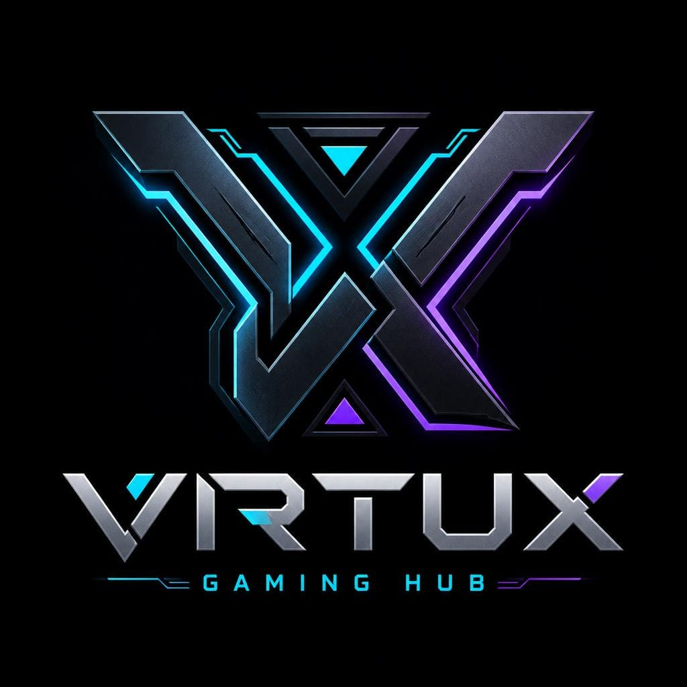

<div align="center">
  
  
  # 🎮 Virtux Gaming Hub

  **Play · Eat · Chill**  
  *Ranaghat's Premier Esports, Simulation & Entertainment Arena*

  [](https://nextjs.org/)
  [](https://react.dev/)
  [](https://www.typescriptlang.org/)
  [](https://tailwindcss.com/)
  [](https://workers.cloudflare.com/)

  <p align="center">
    A high-performance, modern web platform engineered for <strong>Virtux Gaming Hub</strong> — Ranaghat’s first premium gaming lounge featuring 4K 120Hz PlayStation 5 consoles, liquid-cooled RTX battle rigs, Logitech motion sim racing, private Dolby Cinema suites, and an artisan in-house gamer café.
  </p>
</div>

---

## 📖 About Virtux Gaming Hub

**Virtux Gaming Hub** brings tier-1 esports infrastructure to Nadia, West Bengal. Born out of an uncompromised passion for competitive gaming, ultra-high refresh rates, and community culture, the arena offers players access to top-of-the-line gaming gear at fair, transparent hourly rates.

> **🛡️ Ethical & Transparent Gaming Guarantee**  
> Virtux Gaming Hub does not host, promote, or encourage gambling, real-money betting, or speculative games of chance. The hub operates strictly as a rental facility providing gamers access to high-end PlayStation consoles, RTX 4090 PC rigs, and racing simulators.

---

## 🕹️ Arena Zones & Experiences

1. **Sony PlayStation 5 Arena**
   - 4K 120Hz low-latency gaming displays.
   - DualSense wireless controllers with adaptive triggers and haptic feedback.
   - Tempest 3D Audio gaming headsets and an extensive library of 100+ pre-installed titles (EA FC 25, Tekken 8, Marvel's Spider-Man 2, God of War Ragnarök, Mortal Kombat 1).

2. **Liquid-Cooled RTX PC Battle Stations**
   - High-performance rigs powered by NVIDIA GeForce RTX 3060, RTX 4070, and flagship RTX 4090 GPUs.
   - 240Hz and 360Hz esports tournament monitors.
   - Mechanical tactile keyboards, 8000Hz polling rate optical mice, and sub-10ms ping fiber lines for titles like Valorant, CS2, Apex Legends, and Cyberpunk 2077.

3. **Logitech G29 Sim Racing Cockpit**
   - Dual-motor TrueForce feedback racing wheels.
   - Stainless steel paddle shifters and responsive load-cell pedals.
   - Ergonomic racing bucket seats connected directly to PS5 and PC telemetry (Gran Turismo 7, Forza Horizon 5, Assetto Corsa).

4. **Private Dolby Cinema Screening Suite**
   - 150-inch 4K HDR laser projection paired with 7.2-channel Dolby Atmos surround sound.
   - Squad watchparties for live cricket matches, esports finals, movies, and OTT series on Netflix, Hotstar, and Prime Video.

5. **Gourmet Gamer Café & Lounge**
   - Artisan in-house kitchen serving fresh espresso, cold brews, Blue Ocean mocktails, loaded peri-peri fries, gourmet chicken burgers, and molten lava cakes delivered directly to player stations.

---

## 🛠️ Technology Stack

| Layer | Technologies |
| :--- | :--- |
| **Framework** | [Next.js 15.1.7](https://nextjs.org/) (App Router, Static HTML Export) |
| **Frontend Library** | [React 19.0.0](https://react.dev/) & React DOM 19 |
| **Language** | [TypeScript 5.7.3](https://www.typescriptlang.org/) (Strict type safety) |
| **Styling & Design** | [Tailwind CSS 3.4.17](https://tailwindcss.com/), PostCSS, Autoprefixer |
| **Typography** | Orbitron (Display), Rajdhani (Headings & Badges), Inter (Body) via `next/font/google` |
| **Icons & UI** | [Lucide React](https://lucide.dev/), Custom SVGs, Particle Canvas Background |
| **State Management** | React Context API (`StoreContext`) with client-side `localStorage` persistence |
| **Hosting & Edge CDN** | [Cloudflare Workers](https://developers.cloudflare.com/workers/) & [Cloudflare Pages](https://pages.cloudflare.com/) |
| **Edge Deployment Tooling** | [Wrangler 4.x](https://developers.cloudflare.com/workers/wrangler/) (`wrangler.jsonc`) |

---

## 🗺️ Site Architecture & Pages

- **`/` (Home)**: High-impact hero section inspired by gaming editorial design, quick booking modal trigger, active station count, game directory filters, arena zones, pricing preview, and customer reviews.
- **`/about` (About Us)**: Detailed breakdown of the arena philosophy, ethical gaming statement, hardware specifications, amenities (Gigabit Fiber, 21°C Climate Control, 100% UPS backup), and rules of conduct.
- **`/pricing` (Rates & Memberships)**: Comprehensive rate cards for PS5, PC battle rigs, Sim Racing, and Cinema Lounge, along with 10h–100h subscription value packs and weekly/monthly VIP passes.
- **`/cafe` (Gamer Café)**: Interactive digital menu categorized by Burgers, Fries, Hot & Cold Beverages, Energy Drinks, and Desserts with a slide-out order cart drawer.
- **`/gallery` (Arena Gallery)**: Categorized photo showcase of the console arena, PC setups, private cinema lounge, café items, and community tournaments.
- **`/contact` (Contact & Location)**: Operating hours, direct call & WhatsApp links, email support, interactive inquiry form, and Google Maps location guide.
- **`/feedback` (Gamer Reviews)**: Live rating stats, community review cards, and an interactive review submission form.
- **`/login` (Player Access & Security)**: Tabbed authentication interface for Player Login, Registration, Password Reset, and Admin Master PIN login.
- **`/dashboard` (Player Station Pass)**: Gamified player profile, membership ID, loyalty points, active playing session monitor, and quick booking history.
- **`/admin` (Command Center)**: Station live status manager (Available / In-Use / Reserved / Maintenance), incoming booking approval queue, and café kitchen order tracker.

---

## 📂 Project Structure

```
Virtuxgaminghub_Website/
├── public/
│   └── logo.png              # Official Virtux Gaming Hub branding
├── src/
│   ├── app/                  # Next.js App Router routes
│   │   ├── about/page.tsx    # About Us & arena philosophy
│   │   ├── admin/page.tsx    # Admin Command Center
│   │   ├── cafe/page.tsx     # Gourmet Café menu
│   │   ├── contact/page.tsx  # Location, contact form & details
│   │   ├── dashboard/page.tsx# Gamer dashboard & active session
│   │   ├── feedback/page.tsx # Reviews & feedback form
│   │   ├── gallery/page.tsx  # Arena photo gallery
│   │   ├── login/page.tsx    # Player & admin login
│   │   ├── pricing/page.tsx  # Pricing tables & memberships
│   │   ├── globals.css       # Tailwind base, utilities & custom styles
│   │   ├── layout.tsx        # Root layout (fonts, providers, navbar, footer)
│   │   └── page.tsx          # Homepage
│   ├── components/           # Reusable UI components
│   │   ├── AuthModal.tsx     # Popup login / register modal
│   │   ├── BookingModal.tsx  # Station slot booking modal
│   │   ├── CafeCartDrawer.tsx# Slide-over café order cart
│   │   ├── Footer.tsx        # Global footer with hours & legal notice
│   │   ├── Navbar.tsx        # Sticky header with drawer & badges
│   │   ├── ParticleBackground.tsx # Canvas ambient ember particle effect
│   │   └── Toast.tsx         # Notification alerts
│   ├── context/
│   │   └── StoreContext.tsx  # Centralized app state & localStorage sync
│   └── data/                 # Static data catalogs
│       ├── cafeData.ts       # Food, snacks & drink items
│       ├── galleryData.ts    # Photos & category filters
│       ├── gamesData.ts      # PS5 & PC game directory
│       └── pricingData.ts    # Hourly rates & membership packages
├── next.config.js            # Next.js config with static export
├── package.json              # Project dependencies and scripts
├── postcss.config.js         # PostCSS configuration
├── tailwind.config.js        # Custom theme colors, shadows & fonts
├── tsconfig.json             # TypeScript configuration
└── wrangler.jsonc            # Cloudflare Workers / Static Assets config
```

---

## 🚀 Getting Started

### Prerequisites

- [Node.js](https://nodejs.org/) (v18.18.0 or later recommended)
- `npm` (bundled with Node.js)

### Installation

Clone the repository and install dependencies:

```bash
git clone <repo-url>
cd Virtuxgaminghub_Website
npm install
```

### Running Locally (Development Mode)

Start the Next.js development server:

```bash
npm run dev
```

Open [http://localhost:3000](http://localhost:3000) in your browser.

---

## ☁️ Cloudflare Deployment

This project is optimized for deployment on **Cloudflare Workers** or **Cloudflare Pages** using Next.js static export (`output: 'export'`), ensuring zero-latency edge delivery worldwide with no cold starts.

### 1. Build the Application
Generate the production static assets into the `out/` directory:

```bash
npm run build
```

### 2. Preview Locally with Cloudflare Edge Simulator
Test the build locally using Wrangler:

```bash
npm run preview
```
This runs Miniflare at [http://127.0.0.1:8787](http://127.0.0.1:8787) mimicking the Cloudflare production environment.

### 3. Deploy to Cloudflare Workers (CLI)
Authenticate with Cloudflare and deploy:

```bash
npx wrangler login
npm run deploy
```

### 4. Deploy to Cloudflare Pages (Git Integration or CLI)
- **Via CLI:**
  ```bash
  npm run deploy:pages
  ```
- **Via Cloudflare Dashboard (Automated Git Builds):**
  1. Navigate to **Cloudflare Dashboard > Workers & Pages > Create > Pages > Connect to Git**.
  2. Select your repository.
  3. Configure the build settings:
     - **Framework preset**: `Next.js (Static HTML Export)`
     - **Build command**: `npm run build`
     - **Build output directory**: `out`
  4. Click **Save and Deploy**.

---

## 📍 Arena Location & Contact

- **Address**: Srimanta Kundu Lane, Nearby Brojoballav Mandir, Ghotokpara, Ranaghat, Nadia, West Bengal, PIN - 741201
- **Operating Hours**: Monday – Sunday, 10:00 AM – 9:30 PM (Open 7 Days)
- **Phone / WhatsApp**: [+91 91477 18768](tel:+919147718768) / [+91 62947 13465](tel:+916294713465)
- **Email**: [consumersupport.virtuxgaminghub@gmail.com](mailto:consumersupport.virtuxgaminghub@gmail.com)

---

## 📄 License

This project is private and proprietary to **Virtux Gaming Hub**. All rights reserved.
